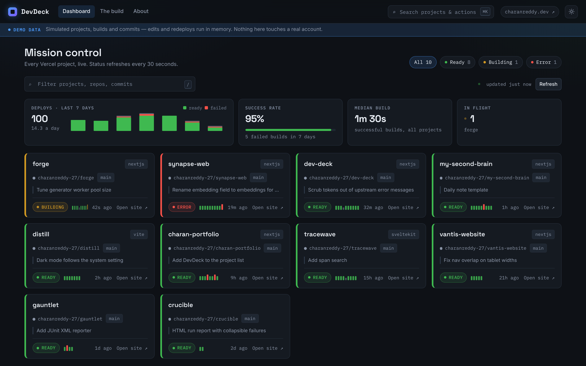
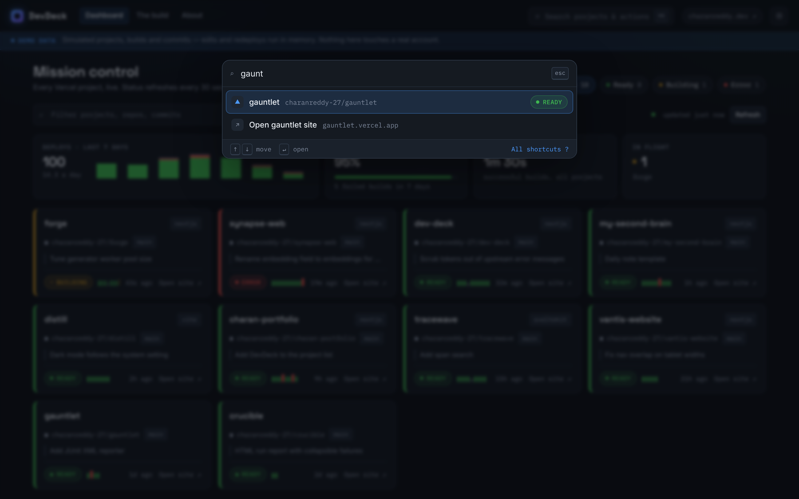
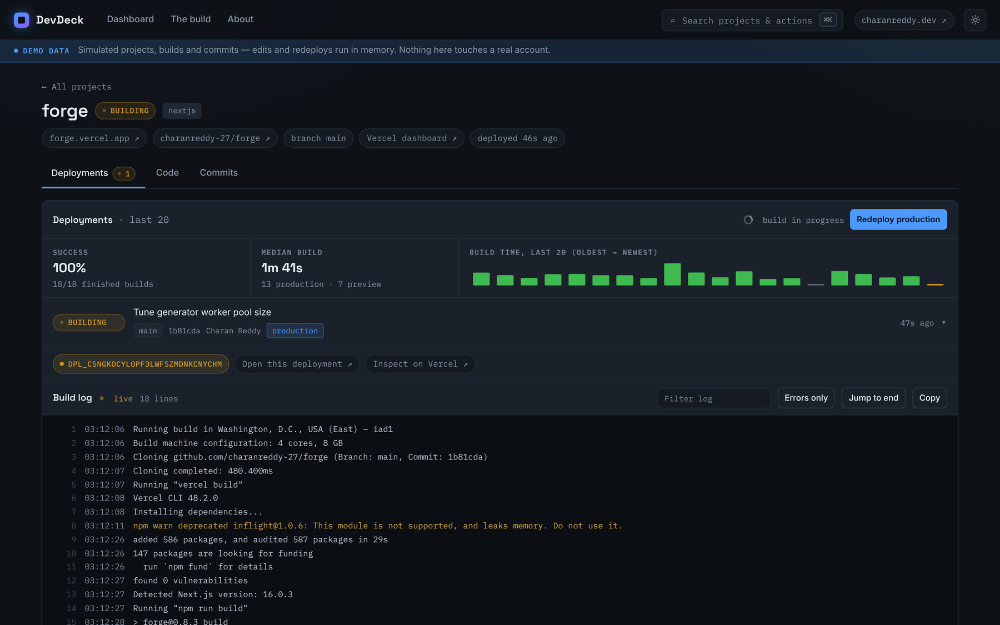
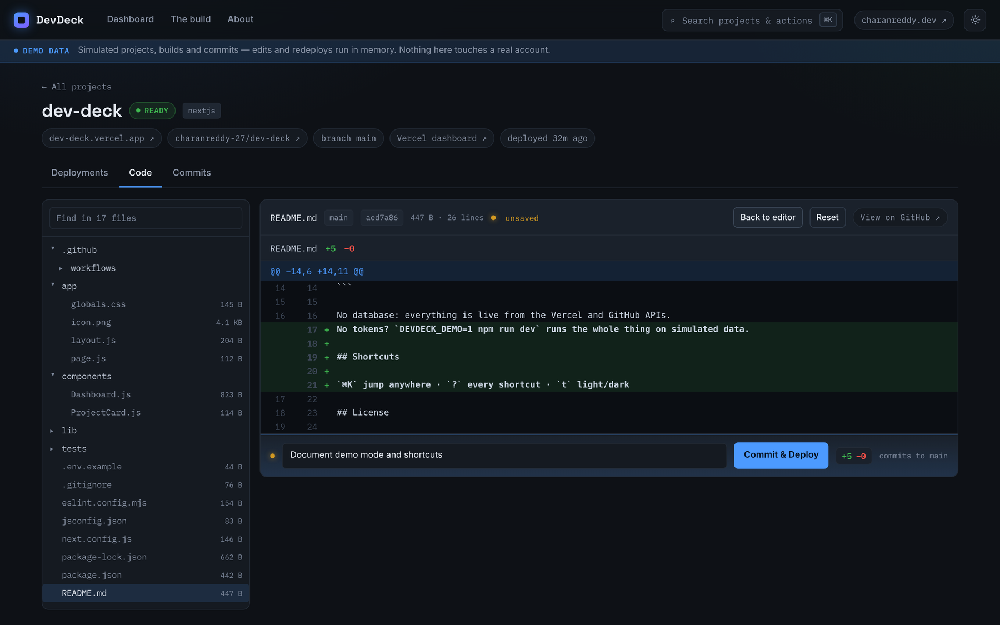
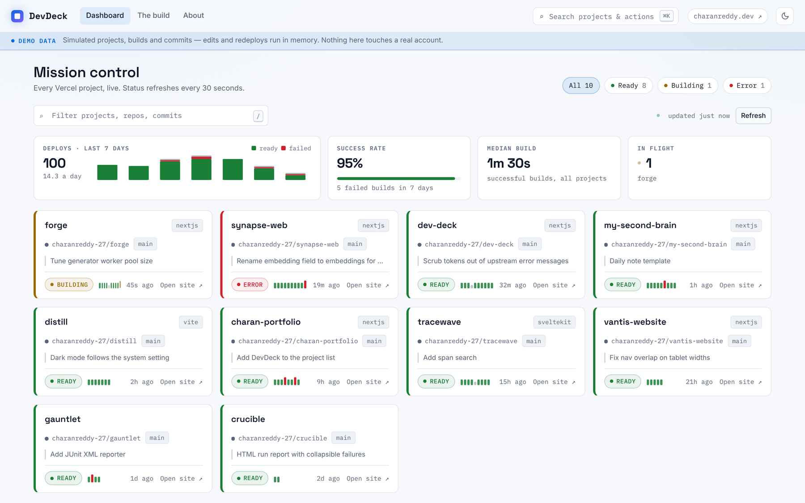
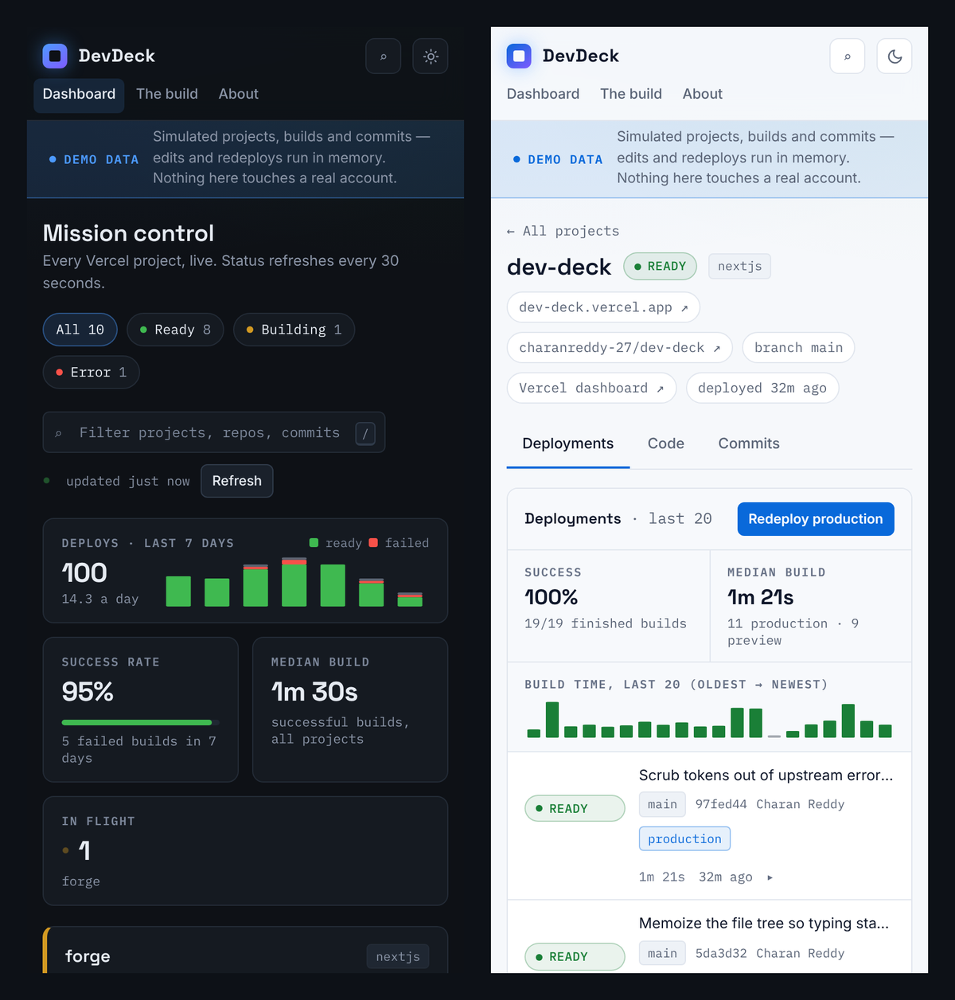

<div align="center">

# DevDeck

**Mission control for everything you ship on Vercel.**

Live deploy status, success rates and build times, streaming build logs, one-click redeploy, and
edit-a-file-into-a-commit for every project in your account, on one screen.

[](https://github.com/charanreddy-27/DevDeck/actions/workflows/ci.yml)
[](https://nextjs.org)
[](https://react.dev)
[](#tests)
[](LICENSE)

**No tokens? `DEVDECK_DEMO=1 npm run dev` runs the whole thing on simulated data.**



</div>

---

## The problem

I ship a lot of small things. Every one lands on Vercel, wired to a GitHub repo, and then quietly
gets on with its life. The trouble starts months later, when someone asks for a link and I don't
actually know whether it still works.

Vercel's dashboard is good at showing you *one* project. It isn't built for **"how are all of
them?"** For me the answer to that lived in about a dozen browser tabs and a certain amount
of hope.

DevDeck answers it in one glance, and gives you the three things you actually reach for when the
answer is bad: the build log, a redeploy button, and a way to fix a one-line mistake without
leaving the page.

## What's new in 2.0

- **Insights.** Deploys per day, success rate, median build time and what's building right now,
  across every project, from one API call. Each card shows its last deploys as a strip of ticks,
  so a project that keeps failing stands out before you read a word.
- **Command palette.** <kbd>⌘K</kbd> / <kbd>Ctrl K</kbd> from anywhere: fuzzy-jump to any
  project, open its live site, switch theme. <kbd>?</kbd> lists every shortcut.
- **Review before you ship.** The Code tab shows the exact diff your commit will make (a Myers
  line diff with real hunks) and keeps a live `+/−` count in the commit bar.
- **Light and dark.** One token set drives both. It follows your OS until you pick, with no flash
  on load.
- **Demo mode.** A seeded, in-memory Vercel + GitHub where builds progress, redeploys queue and
  commits trigger deploys. Try everything with no account and no risk.
- **Password gate.** Set `DEVDECK_PASSWORD` and the whole app (pages and API) sits behind a
  signed, HTTP-only session cookie. That makes a public URL a reasonable thing to have.
- **Next.js 16 and React 19**, ESLint 9 with the React Compiler's hook rules, CI on every push,
  and a layout that holds at 320px.

## Screenshots

| Command palette | Build log, live-tailing |
|---|---|
|  |  |
| **Review the diff, then commit** | **Light theme** |
|  |  |

<p align="center">
  
</p>

## Features

- **Every project, one glance.** Status-railed cards with framework, linked repo, latest
  production commit, deploy time and recent outcomes. Polls every 30s and pauses while the tab is
  hidden. Filter by status, or press <kbd>/</kbd> and type.
- **Deploy insights.** A 7-to-14-day chart of deploys (ready vs failed), success rate, median
  build time and builds in flight. Each project page adds its own success rate, median build and a
  bar per build so a slow one is obvious.
- **Build logs that live-tail.** Expand any deployment for its log. While it's still building the
  log refreshes every 5s and follows the output *unless you've scrolled up to read something*.
  Filterable, errors-only toggle, one-click copy.
- **Edit a file into a deploy.** Browse the linked repo, edit in a line-numbered editor (Tab
  indents, <kbd>⌘S</kbd> / <kbd>Ctrl S</kbd> commits), review the diff, write a message, push.
  Vercel builds the commit. The commit *is* the deploy.
- **Redeploy production.** Rebuilds the production branch, with a confirm step, because a
  one-click production deploy next to a scroll wheel is a bad idea.
- **Errors that tell you the fix.** Every failure carries a code, a message and a hint. A missing
  or rejected token renders the setup guide (with a "try the demo" button) instead of a stack
  trace.
- **No database.** Everything is live from the APIs. No cache to go stale, no schema to migrate.

## Keyboard

| Keys | Does |
|---|---|
| <kbd>⌘K</kbd> / <kbd>Ctrl K</kbd> | Command palette: jump to a project, open its site, run an action |
| <kbd>/</kbd> | Filter projects on the dashboard |
| <kbd>t</kbd> | Toggle light / dark |
| <kbd>?</kbd> | Show every shortcut |
| <kbd>⌘S</kbd> / <kbd>Ctrl S</kbd> | Commit the open file (Code tab) |
| <kbd>Esc</kbd> | Close a dialog |

## Tech stack

| Layer | Choice | Why |
|---|---|---|
| Framework | Next.js 16, App Router, Turbopack | Route handlers put a server between the browser and the tokens without deploying a second service. `proxy.js` gates every request when a password is set |
| UI | React 19 | `useSyncExternalStore` for theme and mode, `useDeferredValue` so the diff count never blocks typing |
| Language | JavaScript | A thin, well-tested layer over two REST APIs, validated at the boundary. Types would have been ceremony |
| Styling | Plain CSS custom properties | One stylesheet, one token set, two themes. A utility framework would have been more config than styling |
| Data | Vercel REST + GitHub REST, or the demo | Every route reads through `lib/source`, which picks live or demo per request. Vercel rebuilds on push, so a GitHub Contents API commit *is* the deploy pipeline |
| Auth | HMAC-SHA256 signed cookie (Web Crypto) | Optional, stateless, no session store. One password, because it protects one person's tokens |
| Charts | Hand-written SVG | Four small charts don't justify a charting library |
| Tests | `node:test` | Zero test dependencies; the logic worth testing is pure functions |
| Persistence | None | The APIs are the source of truth. A cache is just a wronger copy of it |

## Run it locally

```bash
git clone https://github.com/charanreddy-27/DevDeck.git
cd DevDeck
npm install
```

**Just looking?** Run the demo. No tokens, nothing touches a real account:

```bash
DEVDECK_DEMO=1 npm run dev
```

**With your own projects:**

```bash
cp .env.example .env.local   # paste your two tokens
npm run dev
```

Open <http://localhost:3000>. If a token is missing or rejected, the app renders a setup guide
instead of an error. That's the intended first-run experience, and the guide has a button that
opens the demo in your browser only.

Node 20.9 or newer.

### Configuration

| Variable | Required | What it does |
|---|---|---|
| `VERCEL_TOKEN` | for live data | [vercel.com/account/tokens](https://vercel.com/account/tokens) |
| `GITHUB_TOKEN` | for live data | [github.com/settings/tokens](https://github.com/settings/tokens): classic with `repo`, or fine-grained with Contents: read & write |
| `VERCEL_TEAM_ID` | no | Only if your projects live under a team. Appended as `?teamId=` to every Vercel call |
| `DEVDECK_DEMO` | no | `1` serves simulated data to everyone and ignores any tokens. The safe way to host a public demo |
| `DEVDECK_PASSWORD` | no | Turns on the password gate for every page and API route |
| `DEVDECK_SESSION_SECRET` | no | Signs session cookies. Defaults to a key derived from the password; set it to rotate sessions without changing the password |

Tokens are read server-side only and are scrubbed out of any error message before it's returned
or logged. No token string appears in the client bundle; there's a check for that.

## Tests

```bash
npm test        # 91 tests, node:test, no network, no tokens
npm run lint    # ESLint 9 + eslint-config-next, React Compiler hook rules included
npm run build
```

The tests cover the logic that's easy to get quietly wrong: status normalisation, picking the
canonical production alias, the `latestDeployments` fallback, non-GitHub providers, build-duration
maths, relative times, UTF-8 base64 round-tripping, repo-path encoding, secret scrubbing, log
parsing (NDJSON vs array, ANSI stripping, error classification), the live/demo mode rules, the
demo's simulated builds and commits, session signing and expiry, login throttling, activity
aggregation, the diff and the fuzzy ranking. CI runs all three commands on every push.

## Documentation

| Doc | What's in it |
|---|---|
| [CHANGELOG.md](CHANGELOG.md) | What changed in 2.0, and why |
| [PROJECT_DEEP_DIVE.md](PROJECT_DEEP_DIVE.md) | Architecture, data flow, folder structure, tradeoffs, how the hard parts work |
| [DEPLOYMENT.md](DEPLOYMENT.md) | Shipping to Vercel: a public demo, or your own dashboard behind a password |
| [INTERVIEW_PREP.md](INTERVIEW_PREP.md) | Walkthrough, STAR stories, likely Q&A |
| [CONTRIBUTING.md](CONTRIBUTING.md) | Conventions if you're extending it |

## Limits (on purpose)

- Single-file commits to the default branch. No branch creation, no multi-file commits
- Files over 1 MB and binary files are listed but not editable
- If the file changed on GitHub since you loaded it, the commit is rejected with a 409 and a
  message telling you to reload. DevDeck never force-overwrites
- GitLab/Bitbucket projects show status fine, but Code and Commits are GitHub-only
- The password gate is one shared password, not user accounts. It protects one person's tokens;
  **read DEPLOYMENT.md before putting real tokens on a public URL**

---

## About the developer

**Chanda Charan Reddy**, AI & Automation Engineer, Bangalore.

I build intelligent systems, mostly the unglamorous half, where something that looks like magic
in a notebook has to survive real traffic and real people. A Springer-published model that reads
chest X-rays well enough for a radiologist to take seriously; document pipelines that run
themselves. Before that I wrote real-time control code for jet engines at DRDO, where a
millisecond of lag isn't a bug. It's a flameout.

DevDeck is one project. There are twenty more, and a few jet engines, over at
**[charanreddy.dev](https://www.charanreddy.dev)**.

[Portfolio](https://www.charanreddy.dev) ·
[LinkedIn](https://www.linkedin.com/in/chandacharanreddy/) ·
[GitHub](https://github.com/charanreddy-27) ·
[Book a call](https://cal.com/charanreddy-27/30min) ·
[Résumé](https://www.charanreddy.dev/resume.pdf)

*Want to build something, or break something interesting? Let's talk.*

---

<sub>MIT licensed. Crafted with intent.</sub>
